# Moonlit Sands

An [Omarchy](https://omarchy.org) theme. Warm moonlight on a deep blue night sky, for working after dark. Inspired by the Arizona Desert lit by a Harvest Moon. Theme contains optional extras including custom folder icons and app templates that require additional configuration (see below). This is the night companion of [Sunlit Sands](https://github.com/Korrin-F/omarchy-sunlit-sands-theme) light theme.

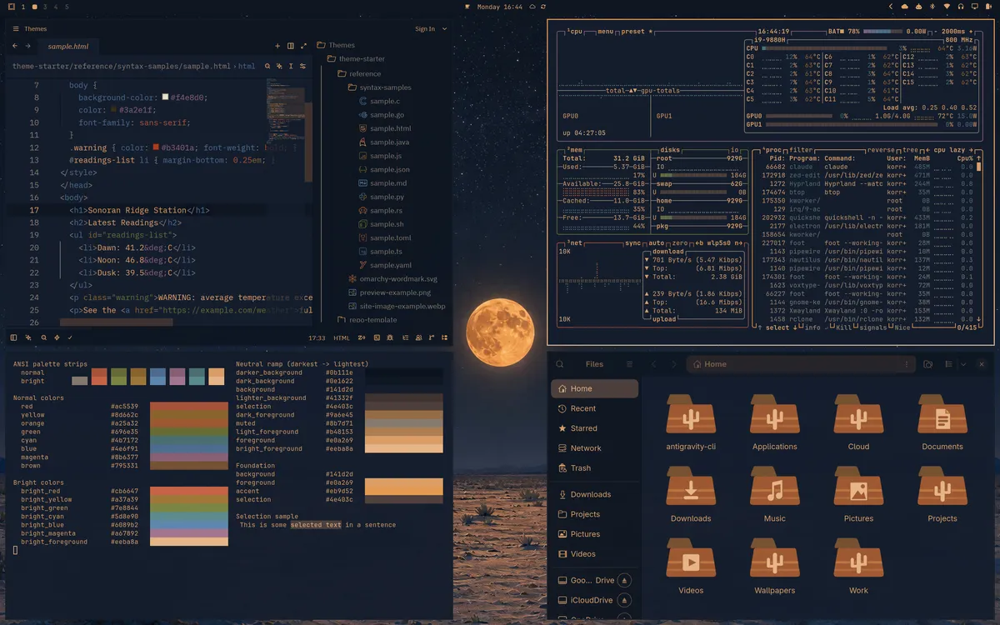

## Install

```
omarchy theme install https://github.com/Korrin-F/omarchy-moonlit-sands-theme
```

Or in Omarchy: Super+Space, then Install > Style > Theme and paste the URL above.

It installs as `moonlit-sands`.

> [!NOTE]
> Not all theme elements are installed fully by this method, if you are interested in a fuller theme, including custom folder icons and more apps that have been customised for this theme, then see the full list of instructions below to install the rest.

## Wallpapers

Six scenes depicting the Arizona Desert on the nights of the Harvest Moon. Painted in the same flat gouache style as Sunlit Sands. Featuring a low orange moon, deep blue skies full of stars and moonlit sands. They are calm enough to keep the bar readable even in transparent mode. Each wallpaper was hand-tuned in Lightroom so the colours and lighting are cohesive across the set. Each of the 6 backgrounds are the same scenes in both Sunlit Sands and Moonlit Sands set at different times of the day to match the theme. 

<p>
  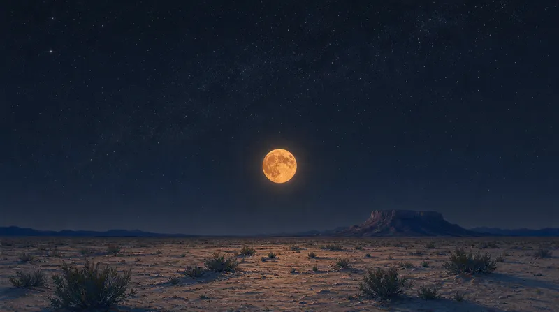
  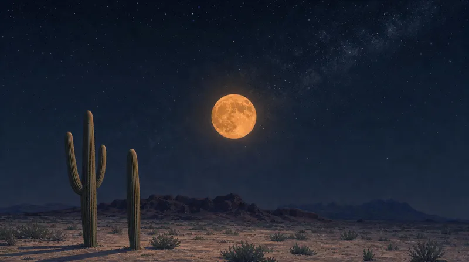
  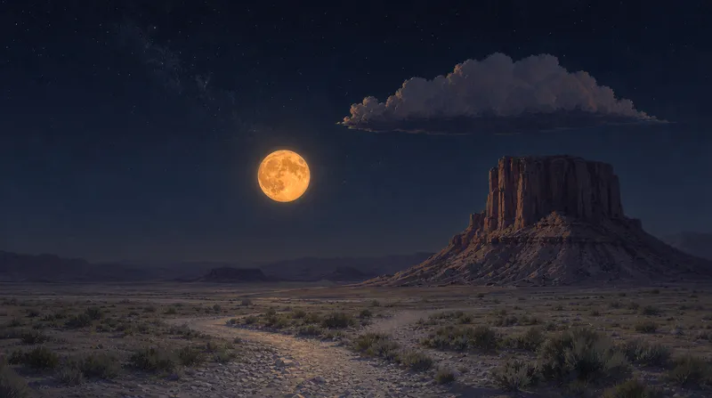
</p>
<p>
  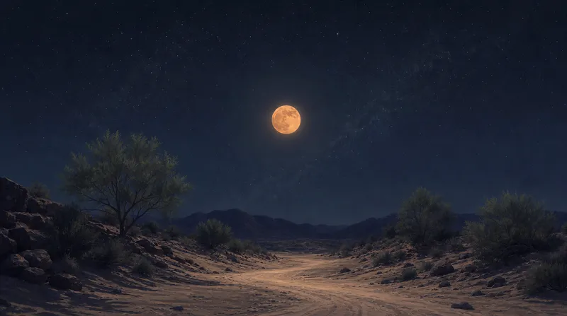
  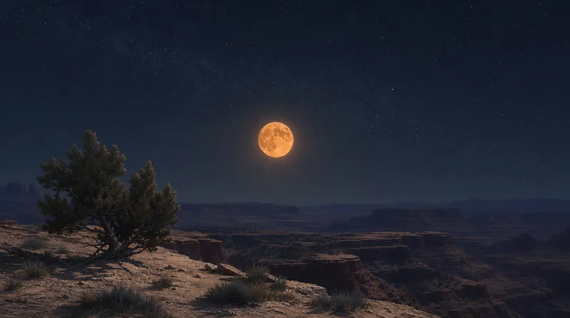
  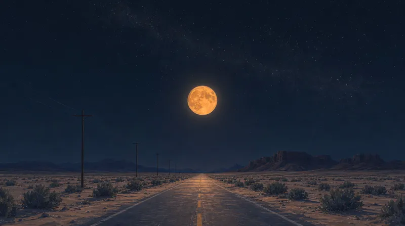
</p>

## Theme Details

The page is the night sky and the text is the moon's light; warm light on the cool night is what reads as moonlight. Sand appears only where the moon reaches it: the hovered row is sand in shadow and the selection the moonlit path. The accent is the gold of the moon's disc, and the terminal palette is the day's terracotta, ochre and sage, softened and warmed as they look under the moon.

Care went into the details. The wallpapers were generated, then each one was hand-tuned in Lightroom so the colours and light agree across the set. The folder icons and the boot logo are Sunlit Sands' hand-drawn mesas and wordmark, recoloured for the night. And every app was opened, inspected on screen and fine-tuned, one at a time.

<p>
  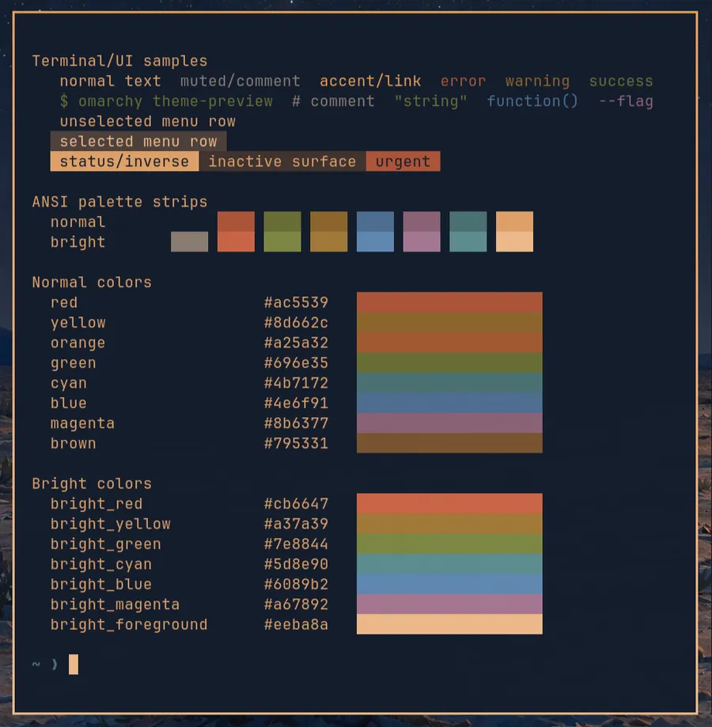
  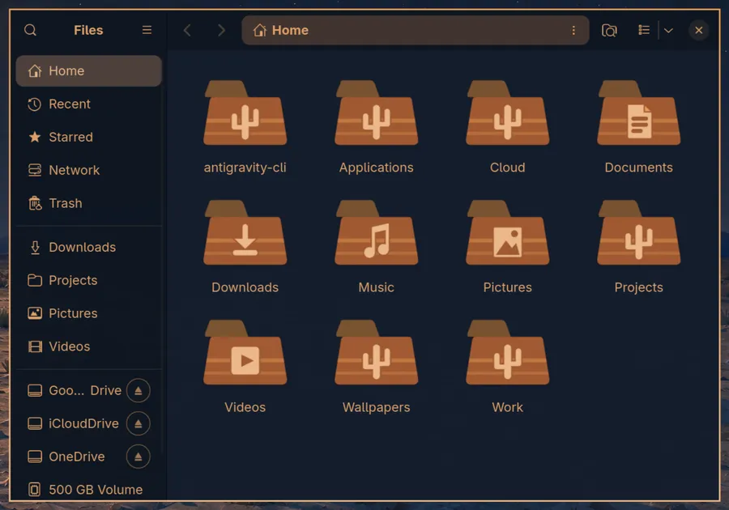
</p>

Left: the full palette in the terminal.\
Right: Files with the theme's custom folder icons, Sunlit Sands' terracotta mesas under the moon. The icon on plain folders is a saguaro cactus, native to the Sonoran Desert.

<p>
  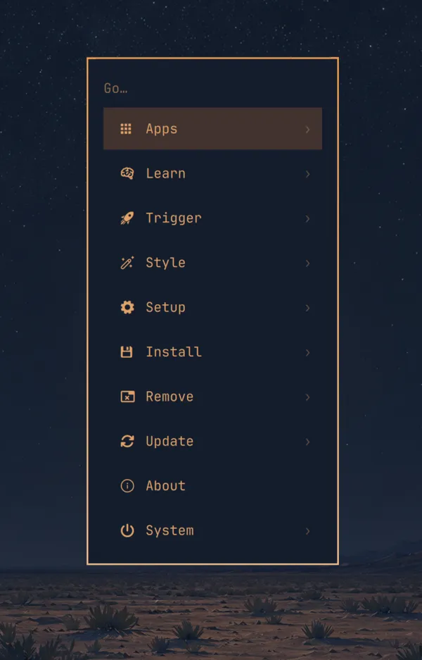
  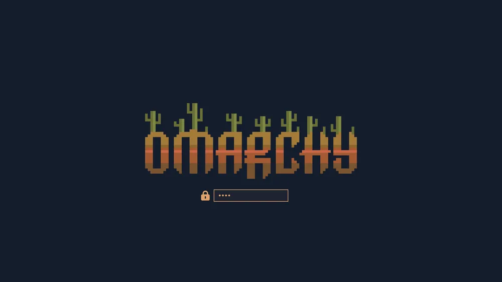
</p>

Left: the Omarchy menu.\
Right: the boot and disk-unlock screen, the Omarchy wordmark as a terracotta mesa in five warm bands with saguaro cacti growing out of the letters, on the night sky.

## What is Themed?

Everything Omarchy themes as standard, plus hand-tuned files for the Omarchy shell (bar, menus, notifications), btop, Helix, Obsidian, VS Code, Claude Code and Pi, Hermes Agent, T3 Code and the screen-share picker, so those apps get the same night-sky page and moonlit text instead of a generic conversion. Files and other GTK apps, Zed and OBS Studio get theirs through the optional extras below.

As with any Omarchy theme, a few apps need one step to activate the theme for the first time:

- Obsidian: Settings > Appearance > Themes > Manage, choose "Omarchy".
- Claude Code: run `omarchy-theme-set-claude --activate` once.
- Pi: run `omarchy-theme-set-pi --activate` once.
- Hermes Agent: run `hermes config set display.skin omarchy`, then `omarchy-theme-set-hermes --activate`, once.
- The boot and disk-unlock screen: in the Omarchy menu, Style > Unlock, choose `moonlit-sands`. It asks for your password and takes about a minute; the new screen shows from the next boot.

## Optional extras

Omarchy themes an app by filling a template with the palette on every theme change, and it lets you add your own templates for apps it has not covered yet. This theme's `extra-templates/` folder holds three such templates, for GTK4 apps (such as the file manager), GTK3 apps (such as the open and save dialogs) and Zed.
Omarchy does not read that folder on its own, so each one takes a single paste: copy the template into Omarchy's user-templates folder, then link the file it produces to where the app looks (instructions are below). The custom icons and the OBS Studio style work the same way but need a small script instead of a template. Hermes Agent and Neovim's file icons need neither, just one setting each, in a file of their own.

### Files and other GTK apps

Gives Files (Nautilus) and other GTK4 apps the night-sky page, moonlit text and sand selection instead of GTK's default look. Paste this once:

```
mkdir -p ~/.config/omarchy/themed ~/.config/gtk-4.0
cp ~/.config/omarchy/themes/moonlit-sands/extra-templates/gtk.css.tpl ~/.config/omarchy/themed/
ln -sfn ~/.local/state/omarchy/current/theme/gtk.css ~/.config/gtk-4.0/gtk.css
omarchy theme refresh
```

Reopen Files to see it. The template follows whichever theme is active, so it keeps working if you switch themes. If you already had a `~/.config/gtk-4.0/gtk.css` of your own, this replaces it.

To undo: `rm ~/.config/omarchy/themed/gtk.css.tpl ~/.config/gtk-4.0/gtk.css`

### File chooser and other GTK3 apps

Gives the open and save dialogs most apps use (the desktop portal's file chooser) and other GTK3 apps the theme's palette instead of GTK's default dark grey. Paste this once:

```
mkdir -p ~/.config/omarchy/themed ~/.config/gtk-3.0
cp ~/.config/omarchy/themes/moonlit-sands/extra-templates/gtk3.css.tpl ~/.config/omarchy/themed/
ln -sfn ~/.local/state/omarchy/current/theme/gtk3.css ~/.config/gtk-3.0/gtk.css
omarchy theme refresh
systemctl --user restart xdg-desktop-portal-gtk
```

The next file dialog that opens shows it; other GTK3 apps show it when they are next started. The template follows whichever theme is active. If you already had a `~/.config/gtk-3.0/gtk.css` of your own, this replaces it.

To undo: `rm ~/.config/omarchy/themed/gtk3.css.tpl ~/.config/gtk-3.0/gtk.css`, then `systemctl --user restart xdg-desktop-portal-gtk`.

### Zed

Gives Zed the same night-sky page, moonlit text and sand selection as the other editors. Paste this once, then pick "Omarchy" in Zed's theme picker (Ctrl+K then Ctrl+T):

```
cp ~/.config/omarchy/themes/moonlit-sands/extra-templates/zed.json.tpl ~/.config/omarchy/themed/
mkdir -p ~/.config/zed/themes
ln -sfn ~/.local/state/omarchy/current/theme/zed.json ~/.config/zed/themes/omarchy.json
omarchy theme refresh
```

Zed reloads it live and follows every theme change from then on. If Omarchy installed Zed for you, it also installed omazed, which keeps offering its own "Omazed" theme in the picker; the two do not interfere.

To undo: `rm ~/.config/omarchy/themed/zed.json.tpl ~/.config/zed/themes/omarchy.json` and pick another theme in Zed.

### Hermes Agent

Omarchy themes Hermes by itself, but Hermes draws its status bar and menus through a library that sends 256 colours unless told otherwise, so those two surfaces come out in the nearest of 256 stock colours instead of the palette. One line in Hermes's settings file fixes it. Paste this once:

```
mkdir -p ~/.hermes
echo 'PROMPT_TOOLKIT_COLOR_DEPTH=DEPTH_24_BIT' >> ~/.hermes/.env
```

`PROMPT_TOOLKIT_COLOR_DEPTH` is an environment variable read by prompt_toolkit, the library Hermes uses for its input line, status bar and menus. `DEPTH_24_BIT` tells it to output the terminal's full 24-bit colour range instead of its 256-colour default. It changes nothing else about Hermes.

Restart Hermes to see it. The line is about Hermes, not this theme, so it keeps working whichever theme is active. If Hermes is not yet following Omarchy's themes at all, run `omarchy-theme-set-hermes --activate` once after Hermes has been started for the first time.

To undo: delete that line from `~/.hermes/.env`.

### Neovim file icons

Omarchy's Neovim colours its file icons from the code colours, so they do not match the theme. This file gives each of the icon colour groups one of the palette's colours by name, so it follows every theme from then on. Paste this once:

```
mkdir -p ~/.config/nvim/lua/plugins
cat > ~/.config/nvim/lua/plugins/omarchy-icons.lua <<'EOF'
return {
  {
    "bjarneo/aether.nvim",
    opts = {
      on_highlights = function(hl, c)
        hl.MiniIconsRed = { fg = c.red }
        hl.MiniIconsOrange = { fg = c.orange }
        hl.MiniIconsYellow = { fg = c.yellow }
        hl.MiniIconsGreen = { fg = c.green }
        hl.MiniIconsCyan = { fg = c.cyan }
        hl.MiniIconsBlue = { fg = c.blue }
        hl.MiniIconsAzure = { fg = c.bright_blue }
        hl.MiniIconsPurple = { fg = c.magenta }
        hl.MiniIconsGrey = { fg = c.muted }
      end,
    },
  },
}
EOF
```

Neovim picks it up on its next start. The file names the palette's colours rather than holding any, so it keeps working whichever theme is active.

To undo: `rm ~/.config/nvim/lua/plugins/omarchy-icons.lua`

### Mesa folder icons

Folder icons drawn for this theme: Sunlit Sands' terracotta mesas recoloured for the night, with a saguaro on the plain folder. The theme installs with Yaru-wartybrown-dark folders, which Omarchy already ships. The theme carries a hook that installs its own icon sets after every theme change: the desktop folder icons, and the VS Code and Zed file icons and OBS Studio's style and icons where the theme ships them. Paste this once:

```
cp ~/.config/omarchy/themes/moonlit-sands/extra-icons/link-theme-icons ~/.config/omarchy/hooks/theme-set.d/
chmod +x ~/.config/omarchy/hooks/theme-set.d/link-theme-icons
omarchy theme refresh
```

VS Code reads its icons when a window opens, so run "Developer: Reload Window" after a theme change. Zed needs one restart after the first install and then follows theme changes on its own. The hook is generic: a theme without a set of a kind leaves that app as it was.

To undo: `rm ~/.config/omarchy/hooks/theme-set.d/link-theme-icons ~/.local/share/icons/Moonlit-Sands` then `omarchy theme refresh`

### OBS Studio

Gives OBS Studio the theme's palette and icons, as a style for OBS's own Yami theme. It needs the icon hook above, which links the style and its icons into OBS after every theme change. Then, once, in OBS: Settings > Appearance, set Theme to Yami and Style to Omarchy, and reopen OBS.

OBS reads its style when it starts, so reopen it to see a theme change.

To undo: pick Yami's Default style in Settings > Appearance. The hook re-makes its two links in `~/.config/obs-studio/themes/` on every theme change; removing the hook, then `rm ~/.config/obs-studio/themes/omarchy.ovt ~/.config/obs-studio/themes/omarchy-icons`, takes them away too.

## Credits and licence

The configuration files and templates are by Korrin-F under the MIT licence (see `LICENSE`). The artwork is by Korrin-F under Creative Commons Attribution-NonCommercial 4.0 (see `LICENSE-ARTWORK`): the six wallpapers, the folder icon set, the boot-screen logo and the screenshots. Credit Korrin-F when you use it; commercial use needs permission. The boot-screen logo is built on the Omarchy wordmark, copyright David Heinemeier Hansson, MIT licence. The VS Code and Zed file icons are recoloured from Seti and Catppuccin and keep their original MIT licences, in their own folders. The OBS Studio icons are recoloured from OBS Studio's own and keep its GPL-2.0 licence, in their folder.
